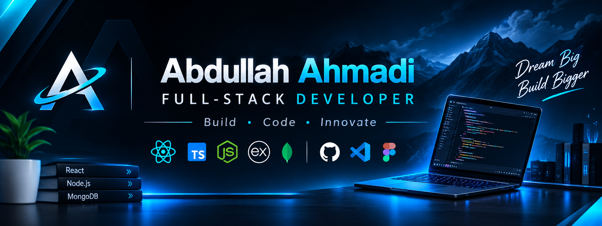

  

# Abdullah Ahmadi
### Full-Stack Developer

I build modern, responsive, and scalable web applications with a focus on clean code, practical functionality, and thoughtful user experiences.

- 💻 Focused on full-stack web development
- ⚛️ Working with React, JavaScript, and TypeScript
- ⚙️ Building backend applications with Node.js and Express
- 🗄️ Working with MongoDB and REST APIs
- 🚀 Continuously building and improving real-world projects

## Featured Projects

### LUMEA — Hotel Booking Platform
A full-stack hotel booking application with hotel discovery, room browsing, authentication, and booking management.

[Live Demo](https://hotel-booking-9761.vercel.app/) · [Source Code](https://github.com/Ajmal-x/Hotel-Booking)

### RAVELO — Car Rental Platform
A car rental application featuring vehicle discovery, booking workflows, and an owner dashboard.

### Trendify — MERN E-Commerce
An e-commerce platform with product management, authentication, shopping cart functionality, and an admin dashboard.

### HireDesk — Applicant Tracking System
A recruitment platform for managing job listings and candidate applications.

## Tech Stack

**Frontend:** React, JavaScript, TypeScript, HTML, CSS, Tailwind CSS

**Backend:** Node.js, Express.js, REST APIs

**Database:** MongoDB

**Tools:** Git, GitHub, VS Code, Postman, Figma

## Current Focus

Improving full-stack architecture, TypeScript skills, application performance, and building production-ready web applications.

---

*Building, learning, and improving — one project at a time.*
